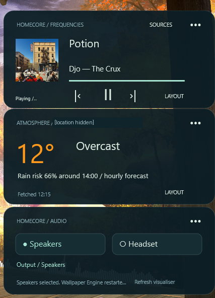
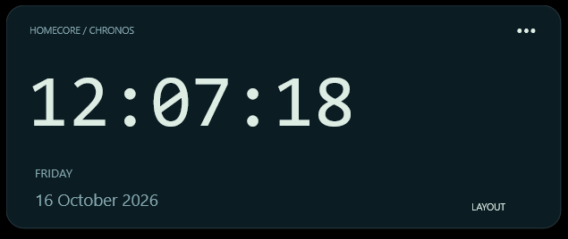
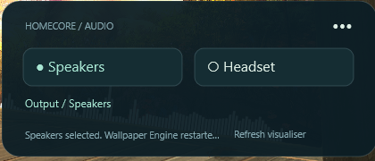
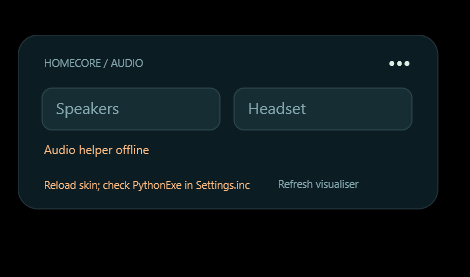

# My Rainmeter desktop widgets

These widgets keep useful information and everyday controls directly on my desktop: server activity, the time, the weather, my music and the choice between speakers and headphones. I can glance at what matters without opening another window.

*Music, weather and audio controls together on the desktop. The weather location is hidden for privacy.*

## Why I built them

I wanted a minimalist desktop that still felt useful. The skins give me a view of my media server, a few things I check throughout the day and control over my audio, in a style that suits my setup.

## Keeping the essentials nearby

Chronos is my clock and date panel. I can choose 12- or 24-hour time, show seconds and adjust its layout, size, colour and opacity.

*The full clock layout keeps the time and date easy to read at a glance.*

Atmosphere is the weather panel. It brings current conditions and an hourly forecast to the desktop, including the chance of rain. Open-Meteo supplies the forecast, which normally refreshes every 15 minutes. If the connection fails, the last forecast stays visible with a stale label.

The separate HomeCore monitoring skin shows Plex activity, server health and storage information from my home server. The clock, weather and music panels work independently of that connection.

## Seeing and controlling my music

Frequencies is the now-playing widget. It shows the title, artist, artwork and playback position supplied by the selected app, with play/pause and track controls where that app supports them.

I can keep it on Apple Music, let it choose a playing source or pin a session. It reads the playback information Windows makes available, so browser players appear only when they share that information. It does not currently offer seeking through a track.

## Switching how I listen

The Audio panel lets me switch between my configured speakers and headphones from the desktop.

*Speakers are selected here, with the headset one click away and a visualiser refresh control underneath.*

After confirming an output change, the audio helper can restart an already-running Wallpaper Engine so its audio visualisers follow the selected output. I can also refresh the visualiser myself. If Wallpaper Engine is closed, the helper leaves it closed.

Apps with their own fixed audio output may still need changing inside that app. The audio helper also needs to be running for the controls to work.

*The offline message tells me why the audio controls are unavailable.*

## Making the desktop my own

I load the panels I want, drag them into place and choose full, compact or minimal companion layouts. During the day I can check the forecast, see what is playing and switch audio without leaving the desktop.

Each companion loads independently, so I can keep a small arrangement rather than having to use the whole set.

## Availability

These are personal Rainmeter skins. The companion set has a local test package, but this page does not currently offer a public skin download. Larger layouts, mixed-scale monitors and sleep/resume still need more testing; media controls also depend on what the player shares with Windows.

## Technology

Rainmeter and Lua, with a C#/.NET helper for Windows media information and a Python helper for audio switching. The HomeCore monitor reads server information; weather comes from Open-Meteo, with attribution under CC BY 4.0.
